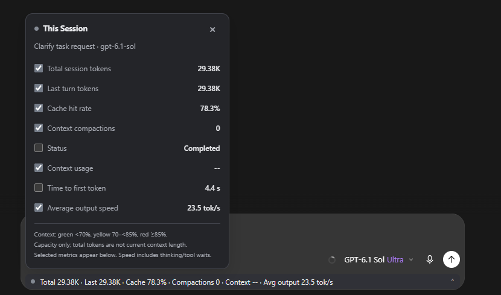

# Codex Session Stats

Lightweight, local session usage for the Windows Codex / ChatGPT Work desktop app. See tokens, context capacity, and average output speed in a compact floating bar or directly below the conversation composer.


*Native UI rendered with sample data. `173/258K` means about 173,000 context tokens used out of 258,000 available.*

[Download for Windows x64](https://github.com/kjw0716/codex-session-stats/releases/latest) · [Changelog](CHANGELOG.md) · [MIT license](LICENSE)

## What's new in v0.2

- **Separate floating window and dashboard.** Closing the dashboard leaves floating statistics running.
- **Small enough for one line.** Resize down to 220 × 40 pixels. Metrics pack by actual text width with two-space gaps, hiding only when they cannot fit.
- **Context at a glance.** Used/capacity counts with a green, yellow, or red dot immediately before them.
- **Adjustable appearance.** Mini, Compact, and Details presets; 35–100% opacity; saved size and pin settings.
- **Relay/API-key provider support.** No provider sign-in is needed when Codex writes compatible local usage records.
- **Desktop shortcut with its own icon.** Optional startup through the configured ChatGPT shortcut.


## Quick start

Windows 11 x64 is the tested platform. Use the Microsoft Store Codex / ChatGPT desktop package (`OpenAI.Codex`) with locally stored Codex/Work conversations. Windows PowerShell 5.1 or newer is required. **Release builds need no Node.js, Python, or compiler.**

1. Download and extract the Windows x64 ZIP from [Releases](https://github.com/kjw0716/codex-session-stats/releases/latest).
2. Open **`Start-SessionStats.cmd`**.
3. Select **Floating window** and click **Start** for immediate use, even if Codex is already open.
4. Use the floating bar's **⋯** menu to choose a conversation. Resize its edges, drag its body, or open **Dashboard** to change opacity.

The floating view shows one manually selected conversation from up to 30 recent, non-archived main sessions. It does not automatically follow the conversation currently visible in Codex. Increase the window's height to reveal metric cards and a conversation picker. Right-click also opens the menu.

Run **`Install-Shortcuts.ps1`** to create the **Session Stats** desktop shortcut. Files are copied to `%LOCALAPPDATA%\CodexSessionStats`; no Windows login service is installed.

### Inside the conversation

Choose **Inside conversation** in Dashboard and click **Start**. This mode follows the selected Codex conversation and adds an expandable statistics panel below the composer.



*An earlier embedded-mode screenshot. Gray and `--` indicate unavailable context data.*

Embedded mode needs the desktop app's loopback debugging interface. If the app was opened without it, the launcher waits for you to exit normally and then reopens it; it never force-closes Codex. **Save startup setting** configures a verified desktop ChatGPT shortcut, preparing embedded statistics on future launches even when automatic statistics startup is off. Taskbar and Start menu entries are not changed. Unknown shortcuts are preserved; the installer creates **ChatGPT (Session Ready)** instead.

To stop both modes, open **`Stop-SessionStats.cmd`**. Codex remains open. Closing just Dashboard leaves an active floating window or embedded helper running.

## Metrics

| Metric | Meaning |
|---|---|
| **Tokens** | Total session consumption, including repeated input across requests. This is not current context length. |
| **Last turn** | Usage for the last completed turn; stays stable while the next turn runs. |
| **Output speed** | Completed turns' output tokens divided by their total duration, in `tok/s`. Includes thinking and tool waits, not pure text-generation speed. |
| **Cache rate** | Cached input tokens divided by input tokens. |
| **Context** | Used tokens / model context capacity. Floating mode reads the latest local request snapshot; embedded mode reads Codex's context component. |
| **Compactions** | Recorded context-compaction events. |
| **Model** | Model recorded for the selected conversation. |

Embedded mode also offers status and time to first model token, which can be a reasoning token. Its checkboxes control the embedded bar. Floating mode fits metrics in this order: tokens, context, speed, cache, last turn, compactions. Hover over the floating bar for exact counts and timing details.

The dot tracks **context occupancy**, never cumulative session consumption:

| Dot | Context capacity used |
|---|---|
| 🟢 Green | Below 70% |
| 🟡 Yellow | 70% to below 85% |
| 🔴 Red | 85% or above |
| ⚪ Gray | Context data unavailable |

These are capacity reminders, not measured model-ability thresholds. Floating context uses the latest recorded request's input plus output tokens and model window; it can lag Codex's live meter. Compaction or model changes clear stale context until a new usable record arrives. No capacity is guessed from the model name.

## Small by design

Native C++ and Win32 UI, with incremental log reading and a compact summary of one selected session. The dashboard and floating window share one process and reader. No persistent Node.js/Python runtime, browser window, or bundled web framework is needed for floating mode.

| Mode | Working set | Private memory | Measurement |
|---|---:|---:|---|
| Embedded helper | 11.23 MB | 2.50 MB | [Earlier local measurement](docs/benchmark.json) |
| Dashboard + floating view | 18.36 MB | 54.84 MB | [Local v0.2 measurement](docs/panel-benchmark.json) |

These measure the helper processes only, excluding Codex and its renderer. They are observations on one Windows 11 machine, not fixed memory limits. The embedded sample added no CPU time over 15 idle seconds; the floating sample added 15.62 ms. Neither implies zero power use.

Usage checks run about every 2.5 seconds during a turn and every 10 seconds after completion. The reader processes appended records rather than retaining conversation bodies. Embedded rendering avoids rewriting unchanged values.

## Data and compatibility

- Reads local SQLite thread metadata and the selected conversation's authoritative JSONL rollout. It does not retain or upload message bodies.
- Works with relay/API-key providers **when compatible usage records exist locally**. Missing usage cannot be reconstructed. These are consumption statistics, not account credits or remaining subscription quota.
- Ordinary Chat and cloud-only conversations do not supply these local Codex logs. Child-agent sessions and missing historical fragments are not merged into the selected main session.
- Floating mode needs no debugging connection. Embedded mode uses **`127.0.0.1:9335`**, verified as loopback-only and owned by the installed desktop app. It does not edit the app bundle, authentication files, source logs, model configuration, or other plugins.
- Embedded conversation discovery and context readings depend on internal app components and can break after app updates. Unavailable readings stay gray / `--`.
- Normal sequential logs, cumulative mirrors, and recent duplicate records are deduplicated. Arbitrary replay of very old request-only records is outside the supported history model.

Preferences and diagnostics are stored in `%LOCALAPPDATA%\CodexSessionMonitor`. Replaced shortcuts are backed up in its `shortcut-backups` directory. The embedded helper exits after its app connection remains unavailable for roughly a minute.

## Build and test

Development requires MinGW-w64 `g++` and `windres` with C++17 support. Tests additionally use Node.js 22.14+ for built-in SQLite fixtures.

```powershell
.\native\build.ps1 -Compiler C:\path\to\g++.exe
.\tests\run-tests.ps1 -Compiler C:\path\to\g++.exe
.\Build-Release.ps1 -Compiler C:\path\to\g++.exe
```

Tests cover 23 native-reader scenarios, 21 embedded UI scenarios, measured-text packing and warning boundaries, and native-panel integration: resizing, opacity, separate-window lifetime, relay records, bounded conversation selection, legacy metadata, and desktop shortcut installation. Fixtures are synthetic and do not control a running Codex app.

## License and credits

MIT licensed. See [LICENSE](LICENSE) and [NOTICE.md](NOTICE.md). The conversation-discovery approach was inspired by [JiaYang-BUAA/Codex-Desktop-Usage-Monitor-Windows](https://github.com/JiaYang-BUAA/Codex-Desktop-Usage-Monitor-Windows). JSON parsing uses [nlohmann/json](https://github.com/nlohmann/json), with its MIT license included.

Independent community project; not affiliated with or endorsed by OpenAI.
