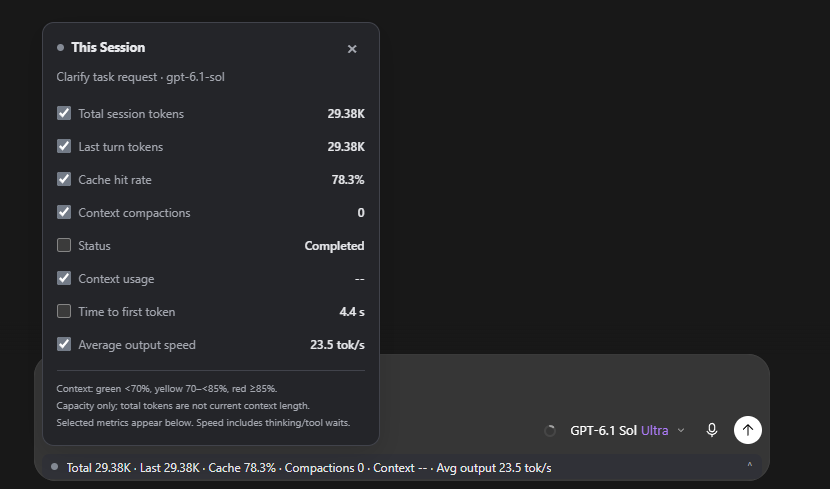

# Codex Session Stats

**A tiny Windows companion that puts session token usage directly inside Codex.**

One native background process. About **11 MB working-set memory** in local testing.
No persistent Node.js or Python runtime. Your statistics follow the conversation you select.



*A real screenshot of the English "This Session" panel. A gray indicator and `--` mean that the current view does not expose native context data.*

## Small by design

- **Native C++ helper:** a single executable, using Windows WinHTTP and the system SQLite library.
- **Incremental log reading:** process newly appended usage events instead of rescanning and retaining an entire conversation history.
- **One selected session:** keep a compact summary, not a cache of every open conversation or its message bodies.
- **Quiet when idle:** about 2.5-second checks while running and 10-second checks after completion. Hidden windows stop requesting statistics.
- **Update only when needed:** unchanged statistics do not rewrite the UI; unchanged connection state does not rewrite the status file.
- **In-app display:** a compact bar below the composer and one expandable panel, with no separate dashboard window.

### Local memory measurement

| Measurement | Earlier Node prototype | Native helper |
|---|---:|---:|
| Working set | 70.4 MB | **11.23 MB** |
| Private memory | 74.9 MB | **2.50 MB** |
| Persistent helper processes | 1 Node.js process | **1 native process** |

The native helper used about **84% less working-set memory** in this measurement.
A 15-second idle sample recorded no additional process CPU time. These are observations from one Windows 11 machine, not universal limits or a promise of zero power use. They measure the helper, not the Codex app or its renderer. The sanitized measurement is in [docs/benchmark.json](docs/benchmark.json).

## What it reads

| Metric | What it means |
|---|---|
| **Total session tokens** | Cumulative usage across the selected conversation's recorded requests, including repeated input context. |
| **Last turn tokens** | Usage for the most recent completed turn; remains stable while the next turn runs. |
| **Cache hit rate** | Cached input tokens divided by input tokens. |
| **Context compactions** | Recorded context-compaction events. |
| **Status** | Running, completed, paused, or not started. |
| **Context usage** | Used tokens, window capacity, and percentage read from **Codex's own context component**. |
| **Time to first token** | Recorded time to the first model token, which can be a reasoning token. |
| **Average output speed** | Completed turns' output tokens divided by their total duration, in `tok/s`. |

Select the checkboxes to choose which metrics appear in the bar. Selections persist across sessions. Counts use `K`, `M`, and `B`; hover over the total for an exact count. Conversation titles retain their original names.

The green/yellow/red indicator uses **native context occupancy**, never cumulative token consumption:

- **Green:** below 70%.
- **Yellow:** 70% to below 85%.
- **Red:** 85% or above.
- **Gray:** native context information is unavailable.

These are capacity reminders, not measured model-ability thresholds. Output speed includes thinking and tool waits, updates after completed turns, and is **not pure text-generation TPS**.

## Quick start

Requirements: Windows with the Microsoft Store Codex/ChatGPT desktop package (`OpenAI.Codex`) and Windows PowerShell 5.1 or newer. Tested on Windows 11 x64. **Node.js, Python, and a compiler are not required to run a release build.**

1. Download the Windows x64 ZIP from [Releases](https://github.com/kjw0716/codex-session-stats/releases/latest) and extract it.
2. For first-time activation, **quit Codex normally**. Closing a window may leave the application running in the background.
3. Double-click **`Start-SessionStats.cmd`** in the extracted folder.
4. Open a locally stored Codex/Work conversation. Click the new bar below the composer to expand the panel.

Use the same start command for later launches. It reuses an existing helper rather than starting duplicates. If an already-running app was opened without the local debugging interface, the launcher asks you to quit normally first; it does not interrupt the conversation.

Double-click **`Stop-SessionStats.cmd`** to stop this helper and remove its panel while leaving Codex open.

PowerShell equivalents:

```powershell
powershell.exe -NoProfile -ExecutionPolicy Bypass -File .\Start-SessionStats.ps1
powershell.exe -NoProfile -ExecutionPolicy Bypass -File .\Stop-SessionStats.ps1
```

The execution-policy setting applies only to that PowerShell process; it does not change the machine's policy.

## Local data and compatibility

The helper reads the selected conversation's authoritative rollout path from local SQLite metadata, then streams its JSONL usage events. It traverses local log records but does **not retain or upload message bodies**. Titles are obtained from local metadata and the session index.

The display connects to the desktop app's local CDP interface at **`127.0.0.1:9335`**. Runtime requests stay on the machine. The launcher validates that this port is loopback-only and belongs to the installed desktop app. It does not edit the app bundle, authentication files, source logs, model configuration, or other plugins. No API key is needed.

Compatibility boundaries:

- Ordinary Chat conversations and cloud-only history do not provide these local Codex logs.
- Context readings depend on Codex's current internal DOM/React/SVG component. App updates can change it; unavailable data stays gray/`--`, with no substitution from cumulative consumption.
- The helper reads the canonical rollout, with a newest-matching-file fallback when metadata is unavailable. It does not merge missing historical fragments or child-agent sessions.
- Deduplication covers normal sequential logs, cumulative usage mirrors, and recent duplicate records. Arbitrary replay of very old request-only records is outside the supported history model.
- This version targets the primary app window of the Microsoft Store desktop package.

Diagnostic files are written to `%LOCALAPPDATA%\CodexSessionMonitor`. The helper exits after the app's local interface remains unavailable for roughly a minute.

## Build and test

For development only: MinGW-w64 `g++` with C++17 support. Node.js is used only for isolated UI tests.

```powershell
.\native\build.ps1
.\tests\run-tests.ps1
.\Build-Release.ps1
```

The test suite covers 23 native-reader scenarios and 21 isolated UI scenarios, including mirrored counts, partial records, compaction resets, large message bodies, session switching, native context precedence, indicator boundaries, stale React values, and low-frequency refresh. Tests use synthetic data and do not control a running Codex app.

## License and credits

MIT licensed. See [LICENSE](LICENSE) and [NOTICE.md](NOTICE.md).

The UI/conversation-discovery approach was inspired by [JiaYang-BUAA/Codex-Desktop-Usage-Monitor-Windows](https://github.com/JiaYang-BUAA/Codex-Desktop-Usage-Monitor-Windows). This project focuses on local session statistics with a native lightweight helper. JSON parsing uses [nlohmann/json](https://github.com/nlohmann/json), with its original MIT license included.

This is an independent community project, not affiliated with or endorsed by OpenAI.
